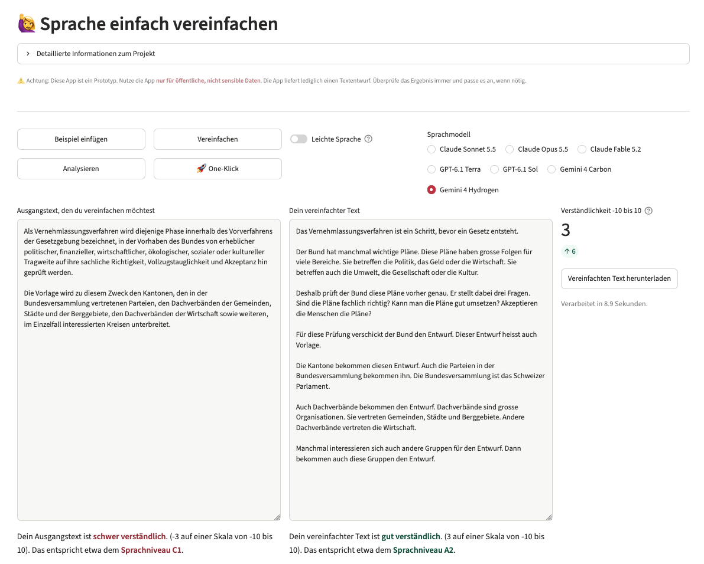
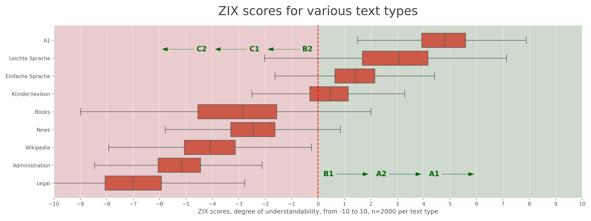

# Simply simplify language

Rewrite German administrative texts in Einfache Sprache or Leichte Sprache,
get sentence-by-sentence writing feedback, and compare drafts from multiple
models. The Canton of Zurich developed this Streamlit prototype.


[](https://github.com/machinelearningZH/simply-simplify-language)
[](https://github.com/machinelearningZH/simply-simplify-language/stargazers)
[](https://github.com/machinelearningZH/simply-simplify-language/issues)
[](https://img.shields.io/github/issues-pr/machinelearningZH/simply-simplify-language)
[](https://github.com/machinelearningZH/simply-simplify-language)
<a href="https://github.com/astral-sh/ruff"></a>

<details>

<summary>Contents</summary>

- [Usage](#usage)
- [Project information](#project-information)
  - [What does the app do?](#what-does-the-app-do)
  - [What does it cost?](#what-does-it-cost)
  - [Our language guidelines](#our-language-guidelines)
  - [How does the understandability score work?](#how-does-the-understandability-score-work)
  - [What does the score mean?](#what-does-the-score-mean)
- [Project team](#project-team)
- [Contributing](#feedback-and-contributing)
- [License](#license)
- [Miscellaneous](#miscellaneous)
- [Disclaimer](#disclaimer)

</details>



> [!IMPORTANT]
> The app sends submitted text to OpenRouter and the routed model provider. Use
> only public, non-sensitive data. Review drafts for errors and omissions, ideally
> with the target audience, especially for Leichte Sprache.

## Usage

### Running Locally

From the repository root, use [uv](https://docs.astral.sh/uv/), Make and Python
3.12 or 3.13. CI tests both versions. The package requires Python 3.12 or newer.

```bash
make sync
cp -n _streamlit_app/.env_example _streamlit_app/.env
```

Set `OPENROUTER_API_KEY` in `_streamlit_app/.env` or the process environment.
Create a key and add credits in your OpenRouter account. [API keys](https://openrouter.ai/keys) · [Credits](https://openrouter.ai/credits)

```bash
make run
```

Open <http://localhost:8501>.

### Running with Docker

Set the key in `_streamlit_app/.env`, then run the following.

```bash
make docker-build
make docker-run
```

Open <http://localhost:8080>. The run target passes `.env` to the container at
startup. `.dockerignore` excludes it from image builds.

### Remote deployment

Use the local or Docker setup on your remote host and provide HTTPS and access
controls. In a Codespace, follow the local setup and forward port 8501.

### Configuring Models

Edit `config.yaml` to customize available models:

- `name`: UI display name
- `id`: OpenRouter model identifier (e.g., `anthropic/claude-opus-5.5`, `openai/gpt-6.1-sol`)
- `reasoning_effort`: Optional reasoning level (`default`, `none`, `minimal`, `low`, `medium`, `high`, `xhigh`, `max`). Use levels supported by the model; `default` uses its own defaults.
- `subprovider`: Optional list of allowed OpenRouter provider or endpoint slugs, e.g. `["openai/flex", "openai"]`. A single slug is also accepted; `default` allows all available providers. The app requests price-based routing and restricts fallback to the allowed list. With a provider restriction or explicit reasoning effort, it requests providers that support the supplied parameters. Live provider availability and parameter support are not verified by repository tests.

Restart the app after editing configuration; it is cached for the running process. Model names and IDs should be unique because the app builds dictionaries from them.

For example, add `reasoning_effort: "medium"` and `subprovider: "openai"` to a model entry. These settings apply to simplification, analysis, and One-Click requests. See [provider selection](https://openrouter.ai/docs/guides/routing/provider-selection) and [reasoning levels](https://openrouter.ai/docs/guides/best-practices/reasoning-tokens).

See the model catalogue at [OpenRouter models](https://openrouter.ai/models).

Other settings in `config.yaml` include a 10,000-character UI input limit, a 120-second API timeout, two SDK retries, and an 8,192-token response limit. `api.temperature: "default"` omits the temperature parameter; a YAML float supplies an override. These values apply to every model request. The UI defaults to Einfache Sprache; enabling Leichte Sprache also exposes the condensation option, enabled by default.

### Data handling

Input and the latest result live in Streamlit session state. The app generates
Word downloads in memory. Optional event logging records text lengths, the
selected model, runtime, mode and success status. Set `logging.enabled: true` to
write JSON lines to `_streamlit_app/app.log` or set `logging.filename` to choose
a path. In One-Click mode, the event records the model selected in the UI.

Model-call failures log exception traces even when event logging is off. Provider
error details can include submitted text. See the [open logging fix](PLAN.md).

## Project information

### What does the app do?

- **Vereinfachen** rewrites text using the selected language level and model.
- **Analysieren** gives sentence-by-sentence feedback on the source.
- **One-Klick** requests a rewrite from every configured model in parallel. It
  shows successful drafts and their scores where available, lists partial failures,
  and displays an error if every model fails.

Download the source and results as a Word document. The prompts use Swiss
Standard German, and the app replaces `ß` with `ss` in displayed results.

### What does it cost?

Model calls use your OpenRouter account. Costs depend on models, input/output tokens, reasoning, and retries; One-Click calls every configured model. The repository contains no current pricing data or cost benchmark. Check [OpenRouter pricing](https://openrouter.ai/models) before use and account separately for hosting costs.

### Our language guidelines

You can find the current rules that are being prompted in [`_streamlit_app/utils_prompts.py`](_streamlit_app/utils_prompts.py). Have a look and change these according to your needs and organizational communication guidelines.

We derived the current rules in the prompts mainly from these of our language guidelines:

- [General language guidelines zh.ch](https://www.zh.ch/de/webangebote-entwickeln-und-gestalten/inhalt/inhalte-gestalten/informationen-bereitstellen/umgang-mit-sprache.html)
- [Language guidelines Leichte Sprache](https://www.zh.ch/de/webangebote-entwickeln-und-gestalten/inhalt/barrierefreiheit/regeln-fuer-leichte-sprache.html)
- [Guidelines Strassenverkehrsamt](https://www.zh.ch/content/dam/zhweb/bilder-dokumente/themen/politik-staat/teilhabe/erfolgsbeispiele-teilhabe/Sprachleitfaden_Strassenverkehrsamt_Maerz_2022.pdf)

### How does the understandability score work?

The [`zix` package](https://github.com/machinelearningZH/zix_understandability-index)
calculates understandability and estimates the CEFR language level. Its Git revision
is pinned in `uv.lock`. The app loads it in the background after rendering the UI.

ZIX uses sentence length, RIX (a readability index), common-word scores and
A1/A2/B1 vocabulary overlap. It scores texts from -10 to +10. Use the score and
CEFR estimate as review aids. Check factual accuracy and language rules separately.

### What does the score mean?

The current UI classifies the unrounded score using `config.yaml`:

- Below -2: hard to understand (`schwer verständlich`).
- From -2 to below 0: moderately understandable (`nur mässig verständlich`).
- From 0: understandable (`gut verständlich`).

These score thresholds are configurable. The displayed numeric score is rounded; CEFR estimates use the unrounded score in every mode. A single simplification shows the output score and change from the source; analysis shows the source score. One-Click shows individual output scores inline and the source score in the metric panel, rather than scoring the combined results.

The app rejects source text that ZIX cannot score before sending a model request. If a generated draft cannot be scored, it remains visible and downloadable with its score marked unavailable.



## Project Team

Project contributors from the cantonal administration of Zurich (affiliations recorded by the project):

- **Simone Luchetta, Roger Zedi** - [Team Informationszugang & Dialog, Staatskanzlei](https://www.zh.ch/de/staatskanzlei/digitale-verwaltung/team.html)
- **Emek Sahin, Peter Hotz** - [Team Kommunikation & Entwicklung, Strassenverkehrsamt](https://www.zh.ch/de/sicherheitsdirektion/strassenverkehrsamt.html)
- **Roger Meier** - [Generalsekretariat, Direktion der Justiz und des Inneren](https://www.zh.ch/de/direktion-der-justiz-und-des-innern/generalsekretariat.html#2092000119)
- **Matthias Mazenauer** - [Co-Leiter, Amt für Statistik und Daten](https://www.zh.ch/de/direktion-der-justiz-und-des-innern/amt-fuer-statistik-und-daten/amtsleitung.html)
- **Marisol Keller, Céline Colombo** - [Koordinationsstelle Teilhabe, Amt für Statistik und Daten](https://www.zh.ch/de/politik-staat/teilhabe.html)
- **Patrick Arnecke, Chantal Amrhein, Dominik Frefel** - [Team Data, Amt für Statistik und Daten](https://www.zh.ch/de/direktion-der-justiz-und-des-innern/amt-fuer-statistik-und-daten/data.html)

Special thanks to [**Government Councillor Jacqueline Fehr**](https://www.zh.ch/en/direktion-der-justiz-und-des-innern/regierungsraetin-jacqueline-fehr.html) for initiating and supporting the project.

## Feedback and Contributing

We welcome feedback and contributions! [Email us](mailto:datashop@statistik.zh.ch) or open an issue or pull request.

We use [`ruff`](https://docs.astral.sh/ruff/) for linting and formatting. Before
submitting a change, run the complete local quality suite:

```bash
make check
```

Run mutation testing with `uv run mutmut run` and inspect survivors with
`uv run mutmut results`. See [engineering notes](NOTES.md#offline-and-mutation-tests)
for the isolated test setup.

Install repository hooks with `make install` (dependency sync plus pre-commit and pre-push hooks). `make check` checks formatting, lint, and tests without modifying files. `make pre-commit` runs configured pre-commit hooks and may change files; pre-push also runs tests and container validation. Container validation skips the build locally if Docker is unavailable; CI requires it.

CI runs pre-commit, tests on Python 3.12/3.13, a full Git-history secret scan, and a container build, health check, and vulnerability scan. The health check tests Streamlit's HTTP endpoint without an API key; it does not validate model calls or ZIX scoring.

Run `make help` for available commands. See [NOTES.md](NOTES.md) for engineering constraints.

### Repository structure

- `_streamlit_app/sprache-vereinfachen.py`: Streamlit UI, API calls, concurrent One-Click requests, session results, and in-memory Word exports.
- `_streamlit_app/app_core.py`: prompt assembly, routing parameters, result formatting, score labels, paths, background ZIX loading, and optional event logging.
- `_streamlit_app/utils_prompts.py`: shared prompts, language rules, and sample text.
- `_streamlit_app/utils_expander.md`: German project information displayed in the app.
- `config.yaml`: models, API limits, UI settings, document formatting, score thresholds, and logging.
- `tests/test_app_core.py`: deterministic core tests; no live-provider or scoring-calibration tests.
- `Dockerfile`, `scripts/validate-container.sh`, `.github/workflows/ci.yaml`: container and CI setup.

## License

This project is licensed under the MIT License. See the [LICENSE](LICENSE) file for details.

## Miscellaneous

- Thanks to [LIIP](https://www.liip.ch/en) for refactoring the understandability index as an [API](https://github.com/chregu/simply-understandability-score) and [webservice](https://u15y.gpt.liip.ch/).
- Special shoutout to [Christian Stocker](https://www.linkedin.com/in/chregu/).
- Thanks to [Florian Georg](https://www.linkedin.com/in/fgeorg/) (Microsoft Switzerland) for help integrating with [Azure AI](https://azure.microsoft.com/en-us/solutions/ai).

## Disclaimer

This software (the Software) incorporates open-source models from [Spacy](https://spacy.io/models) and uses LLMs from various providers (Model(s)). This software has been developed according to and with the intent to be used under Swiss law. Please be aware that the EU Artificial Intelligence Act (EU AI Act) may, under certain circumstances, be applicable to your use of the Software. You are solely responsible for ensuring that your use of the Software as well as of the underlying Models complies with all applicable local, national and international laws and regulations. By using this Software, you acknowledge and agree (a) that it is your responsibility to assess which laws and regulations, in particular regarding the use of AI technologies, are applicable to your intended use and to comply therewith, and (b) that you will hold us harmless from any action, claims, liability or loss in respect of your use of the Software.
